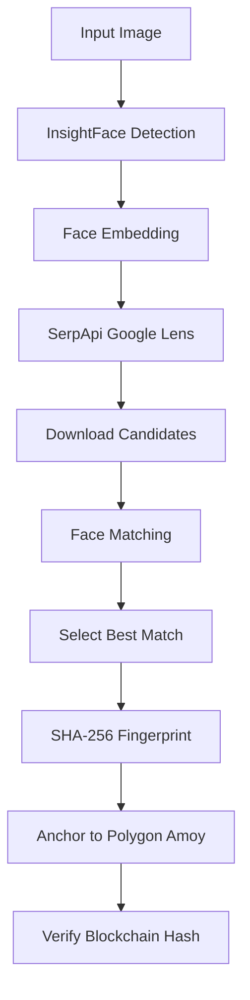

# FaceChain: Face Match Discovery + Blockchain Verification

## Problem
Identity and deepfakes make it hard to verify if a face belongs to a specific social media profile or image. This project dynamically discovers matching public content from a face image, independently verifies the face match, and anchors a cryptographic fingerprint on the Polygon Amoy blockchain.

## What the project does
FaceChain takes a face image, detects and encodes the face locally using InsightFace, then performs a genuine reverse-image search to discover candidate web or social-media content. We independently compare faces in those discovered candidates. Once a matching post is found, we create a deterministic SHA-256 fingerprint of the discovered content and anchor that fingerprint to the Polygon Amoy testnet. During verification, we retrieve the blockchain transaction, recompute the fingerprint locally, and compare the two. If the content changes, the hashes no longer match and the system reports tampering.

## Architecture



## Pipeline
1. Receive uploaded image
2. Detect face and generate embedding
3. Reverse-image search via SerpApi
4. Extract and download candidates
5. Run InsightFace comparison
6. Rank and select verified matching candidate
7. Build canonical content record and SHA-256 fingerprint
8. Anchor fingerprint to Polygon Amoy
9. Verify blockchain hash

## Tech Stack
- Python 3.11
- UI: Streamlit (rescam.org style)
- Face Detection: InsightFace / OpenCV
- Reverse Image Search: SerpApi (Google Lens)
- Blockchain: Polygon Amoy testnet (web3.py)
- Deployment: Fly.io + Docker

## Installation

```bash
git clone <repo>
cd facechain
python -m venv .venv
source .venv/bin/activate
pip install -r requirements.txt
```

## Environment Variables
Create a `.env` file:
```
SERPAPI_KEY=your_key
POLYGON_RPC_URL=https://rpc-amoy.polygon.technology/
PRIVATE_KEY=your_testnet_private_key
WALLET_ADDRESS=your_testnet_wallet_address
```

## SerpApi Setup
Get an API key from serpapi.com. It's used for Google Lens search.

## Polygon Amoy Setup
Use a test wallet. Get test POL from the Polygon faucet. Add your private key and wallet address to `.env`.

## Running locally
```bash
streamlit run app.py
```

## Example test
Upload a photo of a public figure or yourself (if you have public photos). It will detect the face, search the web, find matches, create a SHA-256 hash, and anchor it to Polygon Amoy.

## Blockchain verification
The app automatically checks the transaction hash on Polygon Amoy, decodes the input data, and compares it to the local hash.

## Tamper demonstration
Click "Simulate Tampering" in the UI to see what happens when the local record is altered. The hash will change and trigger a "TAMPER DETECTED" warning.

## Deployment
Deployed via Fly.io using the provided Dockerfile and fly.toml.
```bash
fly deploy
```

## Known limitations
- Search engines/social platforms can change or block results.
- Some candidate images may be inaccessible due to hotlinking protection.
- Polygon Amoy testnet may have RPC rate limits.

## Responsible-use/privacy note
Face matching is not proof of real-world identity. Use consenting test subjects and public/test content. Do not use the system to identify private individuals or stalk people.

## Model/API licensing notes
- InsightFace models are subject to their own licensing.
- SerpApi is a third-party service subject to their terms of service.
