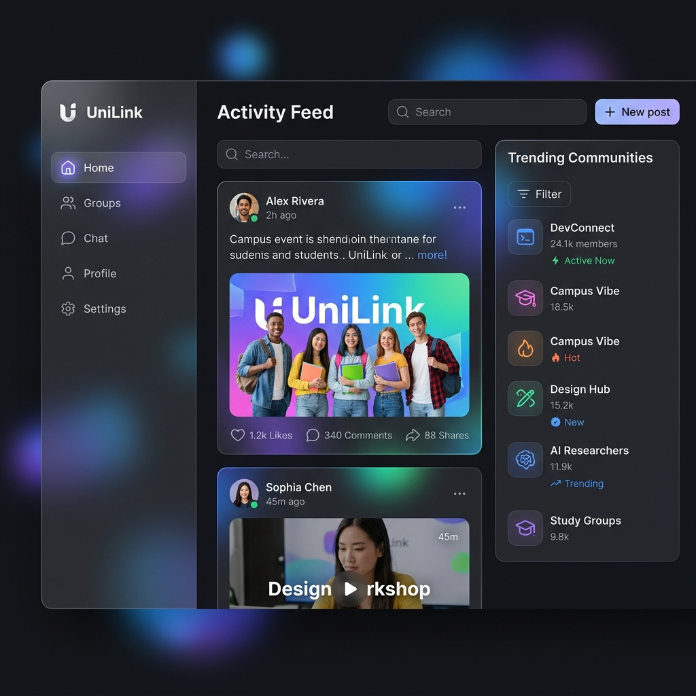
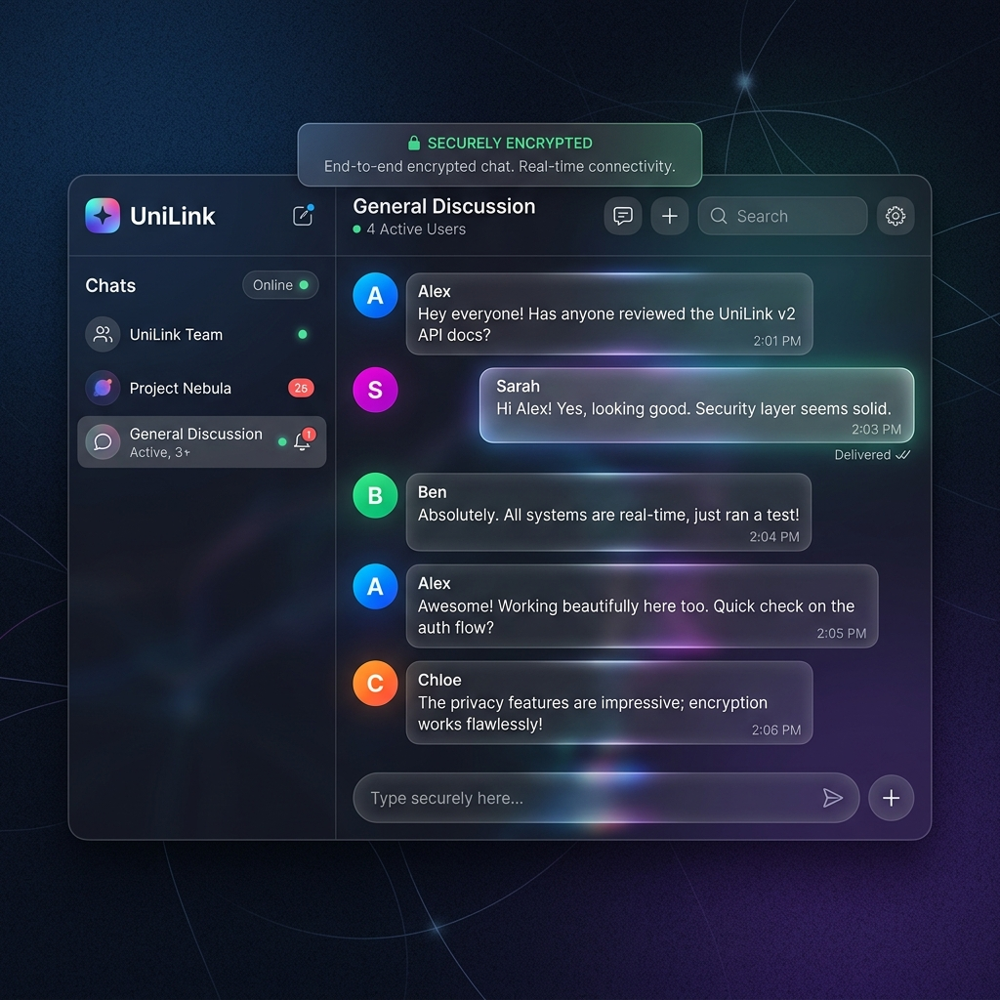
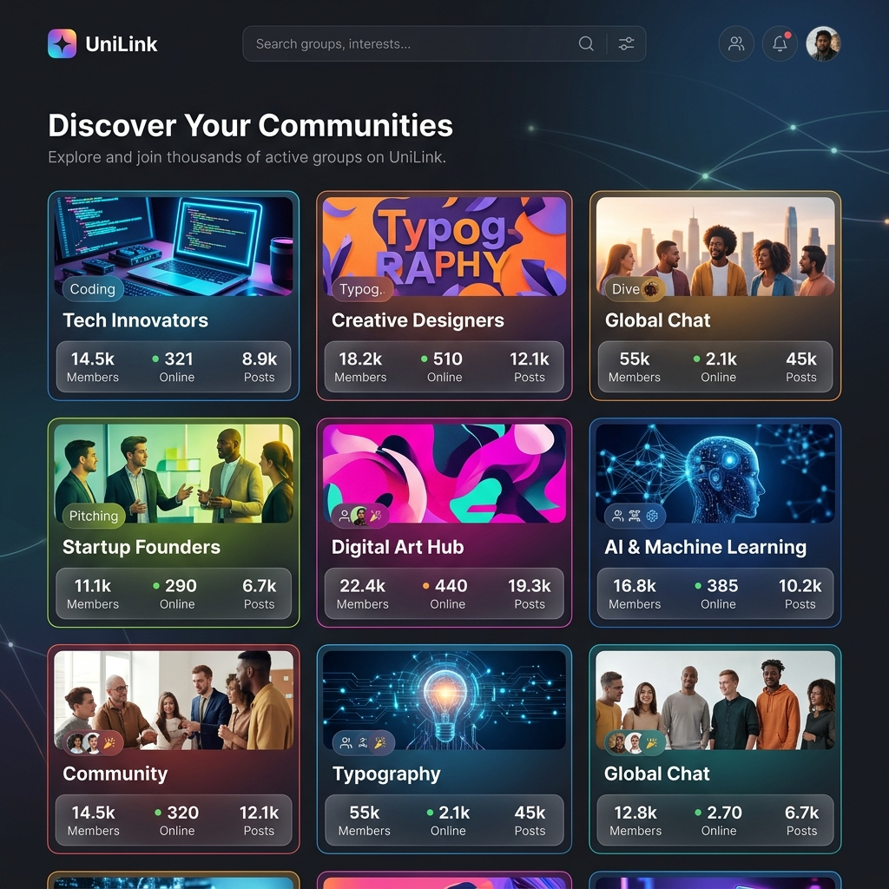
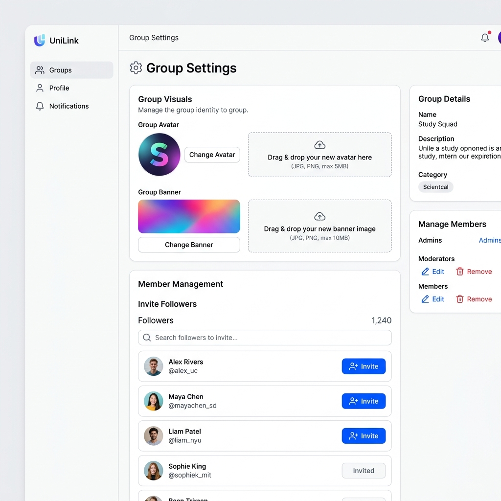

# UniLink — The Ultimate University Social Network

UniLink is a premium, high-performance social networking platform designed specifically for university ecosystems. It facilitates seamless connection, collaboration, and community building among students and faculty.



## 🚀 Key Features

### 1. **Premium Community Groups**
- Create and manage student communities with custom avatars and high-impact banners.
- **Advanced Permissions**: Dynamic creator-only settings and member management.
- **Invitation System**: Invite your followers directly to your communities with a single click.

### 2. **Offline-First Experience**
- **Batch Syncing**: Posts and messages are queued during network instability and automatically batched to the server when connection is restored.
- **Optimistic UI**: Instant feedback on likes, follows, and messages before server confirmation.
- **Local Persistence**: Community chat history is stored locally for instant access.

### 3. **Real-time Community Chats**
- Persistent, multi-member chat rooms for every community.
- **Encrypted Communication**: Secure messaging protocols for private and group interactions.
- **Full History**: New members can access the entire message history of a community from the moment they join.



### 4. **Modern Social Feed**
- High-fidelity posts with media support (images/documents).
- Engagement tools: Likes, nested comments, and real-time activity indicators.
- Profile localization: Track followers, following, and personal achievements.

## 🛠️ Technology Stack

- **Frontend**: React 18, Vite, Framer Motion (Animations), Tailwind CSS (Premium Styling).
- **Backend**: Node.js, Express.js, MongoDB (Mongoose).
- **Real-time**: WebSockets for live chat and notifications.
- **Media**: Cloudinary integration for lightning-fast image and banner delivery.
- **Storage**: Offline batching using custom local-first logic.

## 📦 Required Files & Configuration

To run UniLink, you need to set up the following environment variables:

### Backend (`backend/.env`)
```env
PORT=5000
MONGO_URI=your_mongodb_connection_string
JWT_SECRET=your_jwt_strong_secret
CLOUDINARY_CLOUD_NAME=your_name
CLOUDINARY_API_KEY=your_key
CLOUDINARY_API_SECRET=your_secret
```

### Frontend (`frontend/.env`)
```env
VITE_API_URL=http://localhost:5000
```

## 🏃 Getting Started

### Prerequisites
- Node.js (v18+)
- MongoDB (Local or Atlas)
- Cloudinary Account (for media uploads)

### Installation

1. **Clone the repository**:
   ```bash
   git clone https://github.com/PTejasKr/Unilink.git
   ```

2. **Backend Setup**:
   ```bash
   cd backend
   npm install
   npm start
   ```

3. **Frontend Setup**:
   ```bash
   cd ../frontend
   npm install
   npm run dev
   ```

## 📸 Screenshots

### Community Discovery


### Group Management & Settings


## 📄 License
This project is licensed under the MIT License.