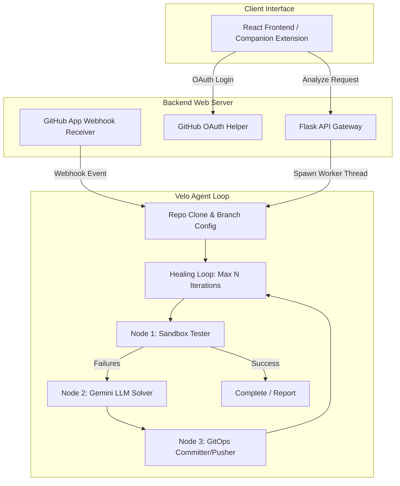

# Velo — System Architecture & Flow

This document details the software architecture, monorepo design, execution flow, and integrations of the **Velo Autonomous CI/CD Healing Agent**.

---

## 1. System Overview

Velo is built to autonomously resolve code issues (syntax errors, logic bugs, failing tests, and dependency mismatches) across multiple programming languages. It runs either as a server-side **GitHub App** responding to PR events, or via a **Client-Only React Dashboard** for manual triggering.

---

## 2. Core Architectural Components

### A. Frontend: React Dashboard
The frontend is a lightweight, responsive SPA styled with premium dark-mode aesthetics. It features:
*   **120Hz Smooth Interaction:** High-fps canvas background tracking mouse movement, rendering a perspective 3D grid without dropping frames.
*   **State Management:** Tracks repository analysis state, real-time log streaming (SSE), and interactive file diff comparisons.
*   **Modern Navbar & Dropdowns:** A glassmorphic floating menu and base-menu profile selector with options like profile, requests, settings, and logout.
*   **Mecha Typography:** Cyberpunk-inspired aesthetic headings utilizing the high-fidelity `Mecha` font family.

### B. Backend: Flask Web Server
The backend exposes API endpoints for OAuth authentication, live logging streams, and GitHub App webhooks.
*   **Signature Verification:** Employs HMAC-SHA256 signature verification on inbound webhooks from GitHub.
*   **Thread Pools:** Spawns asynchronous worker threads to execute the resource-heavy cloning and healing loops without blocking the main event loop.
*   **DB Model:** Keeps track of suspicious actions, authenticated users, and baseline parameters.

### C. Multi-Node Healing Agent
The autonomous healing engine works in three sequential steps per iteration:
1.  **Node 1 (Sandbox Tester):** Discovers and runs tests on the target project (supporting Go, Java, Python, C, and JavaScript). If all tests pass, the agent completes successfully.
2.  **Node 2 (LLM Solver):** Reads stdout/stderr error logs from failing tests. It formats them into a structured prompt, requesting Google Gemini (`gemini-3.5-flash` or `gemini-3.5-pro`) to locate the source code line and provide a precise patch.
3.  **Node 3 (GitOps Engine):** Applies the patch, runs validation tests inside the sandbox, commits the result to git with developer-like shorthand commit messages, and pushes the branch to GitHub.

---

## 3. GitHub App Integration Flow

The server operates a first-class GitHub App integration utilizing Check Runs:

```mermaid
sequenceDiagram
    participant GH as GitHub Developer Platform
    participant Velo as Velo Backend Server
    participant Worker as Velo Worker Thread

    GH->>Velo: POST /api/github/webhook (PR opened/synchronize)
    Velo->>Velo: Verify HMAC-SHA256 signature
    Velo->>Velo: Generate RS256 JWT using GITHUB_APP_ID & Private Key
    Velo->>GH: POST /app/installations/:id/access_tokens (Exchange JWT)
    GH-->>Velo: Return Installation Access Token
    Velo->>GH: POST /repos/:owner/:repo/check-runs (Create "Velo CI/CD Healing")
    GH-->>Velo: Return Check Run ID
    Velo->>Worker: Spawn background task
    Velo-->>GH: 202 Accepted
    
    rect rgb(20, 20, 30)
        Note over Worker: Execute Autonomous Healing Loop
        Worker->>GH: PATCH /check-runs/:id (status: "in_progress")
        Worker->>GH: Git push branch changes
        Worker->>GH: PATCH /check-runs/:id (conclusion: "success" or "failure")
    end
```

---

## 4. Sandbox Safety & Isolation

To protect the host server from arbitrary code execution during test suites:
*   Every test run is executed inside a temporary, short-lived Docker container.
*   The container has strict memory boundaries (e.g. max 2GB) and CPU cores limits.
*   Network access is disabled or restricted during test execution.
*   The temporary directories are cleaned up unconditionally using `shutil.rmtree` at the end of every pipeline execution.
