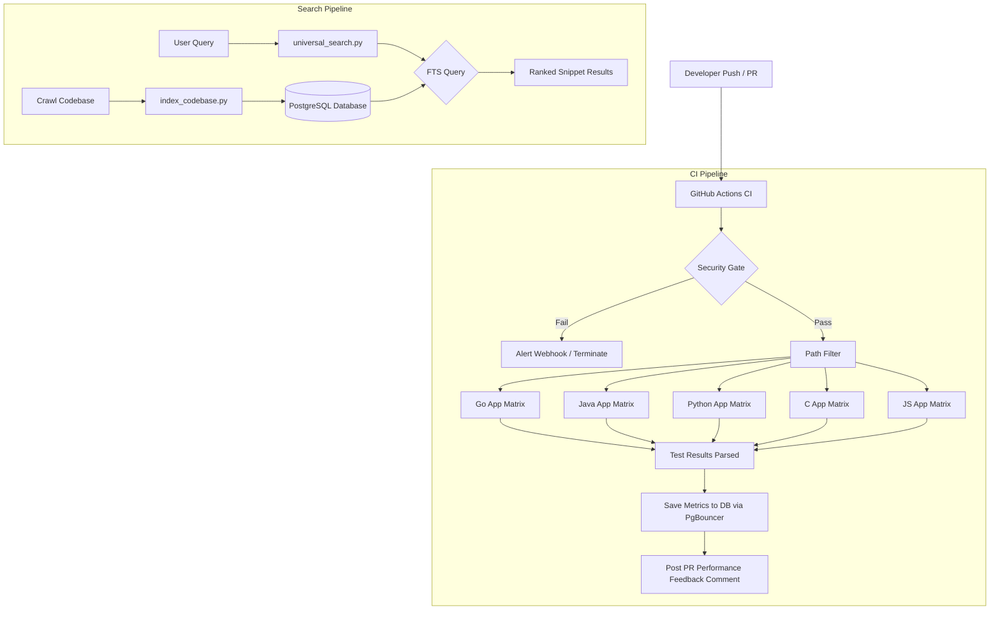

# Polyglot Monorepo CI/CD & Search Engine

An enterprise-ready, polyglot monorepo template hosting Go, Java, Python, C, and JavaScript services. Built to demonstrate production-grade CI/CD automation, hardened containerized database infrastructure, and a custom PostgreSQL-backed full-text search engine.

---

## Architecture Flow



---

## Key Features

1. **Path-Filtered Parallel Matrix Builds:** Workflow automatically runs isolated checkouts, linting, tests, and coverage calculations only for modified directories.
2. **Hardened Pre-Job Security Firewall:** Verifies the PR trigger actor against a strict allowlist. Sends signed webhooks upon unauthorized access and terminates the run before spinning up compute nodes.
3. **Database Performance Ledger:** Automatically logs test count, duration, and test coverage metrics into a centralized PostgreSQL instance on every run.
4. **Resilient Database Layer:** Relies on transaction-mode PgBouncer connection pooling and `tenacity` exponential retry logic to absorb high-concurrency spikes.
5. **Universal Full-Text Search (FTS):** Built-in code indexing engine and CLI client leveraging Postgres lexical tokenization (`tsvector`), ranking (`ts_rank`), and context extraction (`ts_headline`).

---

## Project Structure

```
enterprise-monorepo/
├── .github/workflows/          # Hardened GHA CI workflows
├── go-app/                     # Go HTTP health service & tests
├── java-app/                   # Java Maven project & surefire tests
├── python-app/                 # Python app using uv/pytest
├── c-app/                      # C app with custom test runner Makefile
├── js-app/                     # JS Node service with Jest & ESLint
├── tools/                      # Shared Python CI & search utilities
├── migrations/                 # Forward-only SQL database migrations
└── infra/                      # Docker Postgres & PgBouncer configs
```

---

## Setup & Execution

### 1. Database & Proxy Infrastructure
Run PgBouncer and PostgreSQL:
```bash
cd infra
cp .env.example .env
docker compose up -d
```

### 2. Database Migrations
Apply versioned database schema changes:
```bash
python migrations/migrate.py
```

### 3. Run Universal Search
Index code files and perform lexical search queries:
```bash
# Index codebase
python tools/index_codebase.py

# Query term
python tools/universal_search.py --query "calculateDelta"
```
